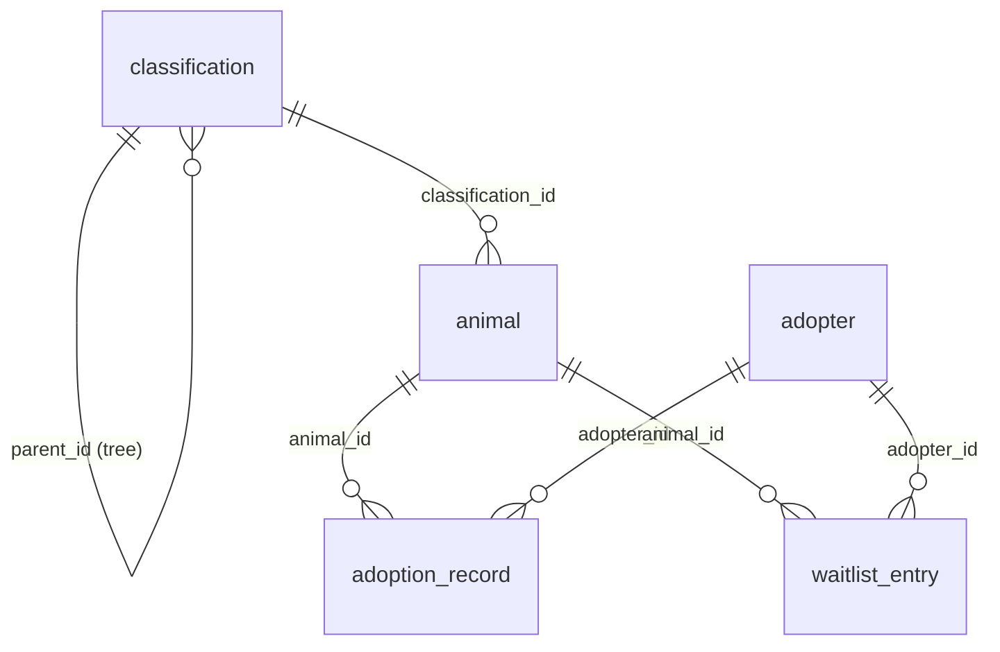

# Pet Shelter & Adoption Tracker

A desktop application for a small animal shelter: list animals, import a large
historical intake/adoption log, record adoption interest, mark animals adopted,
and explore shelter analytics with charts.

Built in **Java (Swing + JDBC + SQLite)**, tested with **JUnit 5**, built with
**Maven** (bundled wrapper, nothing to install).

---

## 1. Quick start

Requirements: **JDK 17 or newer** on your `PATH` (this project was developed on
JDK 25). Maven does **not** need to be installed - the Maven Wrapper (`mvnw`)
downloads and caches it automatically.

```bat
:: Run the test suite (62 JUnit 5 tests)
mvnw.cmd test

:: Build and start the GUI (builds the jar automatically on first run)
run-gui.cmd

:: Or do it manually:
mvnw.cmd -q -DskipTests package
java -jar target\pet-shelter-tracker.jar

:: Or run straight from sources without packaging:
mvnw.cmd -q compile exec:java
```

macOS / Linux: `./mvnw test`, `./mvnw -q -DskipTests package && java -jar target/pet-shelter-tracker.jar`

The application creates `petshelter.db` (SQLite) next to the jar's working
directory on first run and seeds a small demo dataset. To reset everything,
delete `petshelter.db`.

### Sample data

A large historical intake/adoption log lives in `data/intake_history.csv`
(6,000 rows, ~440 KB). Regenerate it at any time with:

```powershell
powershell -ExecutionPolicy Bypass -File scripts\generate_csv.ps1 -Rows 6000
```

---

## 2. Mandatory technical requirements -> where they live

| # | Requirement | Implementation |
|---|-------------|----------------|
| 1 | **OOD**: abstract class/interface + 2+ concrete implementations, SRP | Abstract class `Animal` with concrete `Dog`, `Cat`, `OtherAnimal` (each with its own adoption-fee and care-schedule rules). Second interface `PetImageService` with `DogCeoImageService` + `CatApiImageService`. SRP is enforced by splitting DAO / service / GUI layers. |
| 2 | **Stack, Queue, Map + non-trivial recursion** | Queue: `WaitlistService` (per-animal `ArrayDeque` FIFO waitlist). Stack: `StatusHistoryService` (`ArrayDeque` push/pop = undo). Maps: `AnalyticsService` frequency maps, `groupByClassification`, `WaitlistService` queues keyed by animal. Recursion: `ClassificationNode.findByPath / searchByName / depth / countNodes / path`, `AnalyticsService.countRecursive` (roll-up), `DogCeoImageService.collectBreeds` (JSON tree). |
| 3 | **Automated testing**: 6+ JUnit 5 tests, standard + edge cases | 9 test classes / **62 tests** in `src/test/java` (fee boundary values, empty queue, empty undo stack, negative shelter stay, malformed CSV rows, FK violations, duplicate emails, empty JSON responses, ...). |
| 4 | **ER model (3+ entities) + SQLite via JDBC / PreparedStatement** | 5 related tables: `classification`, `animal`, `adopter`, `adoption_record`, `waitlist_entry`. Every query uses `PreparedStatement` (see `com.petshelter.db.*`). |
| 5 | **REST API consumption + JSON parsing used in logic** | Live call to the Dog CEO API (`/breeds/image/random`, `/breed/{breed}/images/random`, `/breeds/list/all`) and TheCatAPI (`/images/search`). Parsed with `org.json` and used to resolve breeds and display images. |
| 6 | **Event-driven GUI with 3+ controls + handlers** | Swing GUI: 6 buttons, a classification filter combo box, a metric combo box, table selection, file chooser - all wired to `ActionListener` / `ListSelectionListener` handlers in `MainFrame`. |
| 7 | **Concurrency** | CSV import runs on a `SwingWorker` (`ImportWorker`) with live progress; API/image downloads run on a second `SwingWorker` (`ImageWorker`). The Event Dispatch Thread never blocks. |
| 8 | **Data mining** | `AnalyticsService.analyze` mines most-adopted species/breed (frequency analysis) and average shelter stay length overall and per species. |
| 9 | **Data visualization** | `BarChartPanel` - a clearly labelled bar chart (title, category axis, value axis, grid ticks, value labels, rotated category labels) rendered by the analytics dashboard. |

### GUI features from the brief

| Feature | Control |
|---|---|
| List an animal | *List / Refresh Animals* + animal table |
| Import intake history | *Import Intake History (CSV)* (background thread + progress bar) |
| Record interest | *Record Interest* (adds to the Queue, sets status `PENDING`) |
| Mark adopted | *Mark Adopted* (creates adoption record, serves the waitlist) |
| View shelter analytics | *Shelter Analytics* tab with bar chart + mined summary |
| Undo last status change | *Undo Last Status Change* (Stack pop) |
| Sample pet image | *Fetch Sample Pet Image* (live API, background download) |

---

## 3. Entity-Relationship model

Five entities, two of which are optional relationship entities
(`adoption_record`, `waitlist_entry`).



**classification** - the species/breed taxonomy tree (self-referencing, any depth)

| column | type | key |
|---|---|---|
| id | INTEGER | PK |
| name | TEXT | e.g. `Golden Retriever` |
| parent_id | INTEGER | FK -> classification.id (null = root) |

**animal** - one shelter resident

| column | type | key |
|---|---|---|
| id | INTEGER | PK |
| name, species, breed | TEXT | |
| age_months | INTEGER | CHECK >= 0 |
| intake_date | TEXT | ISO `yyyy-MM-dd` |
| status | TEXT | `INTAKE / AVAILABLE / PENDING / ADOPTED / RETURNED` |
| classification_id | INTEGER | FK -> classification.id |

**adopter** - a person interested in adopting

| column | type | key |
|---|---|---|
| id | INTEGER | PK |
| name | TEXT | |
| email | TEXT | UNIQUE `COLLATE NOCASE` (natural key) |
| phone | TEXT | |

**adoption_record** - completed adoption (animal N:1, adopter N:1)

| column | type | key |
|---|---|---|
| id | INTEGER | PK |
| animal_id | INTEGER | FK -> animal.id |
| adopter_id | INTEGER | FK -> adopter.id |
| adoption_date | TEXT | |
| fee_paid | REAL | |

**waitlist_entry** - mirrors the in-memory Queue (animal N:1, adopter N:1)

| column | type | key |
|---|---|---|
| id | INTEGER | PK |
| animal_id | INTEGER | FK -> animal.id |
| adopter_id | INTEGER | FK -> adopter.id |
| requested_at | TEXT | ISO timestamp |
| position | INTEGER | 1-based Queue position |

Relationships: `classification 1 - N classification` (tree),
`classification 1 - N animal`, `animal 1 - N adoption_record`,
`adopter 1 - N adoption_record`, `animal 1 - N waitlist_entry`,
`adopter 1 - N waitlist_entry`. Foreign keys are enforced
(`PRAGMA foreign_keys = ON`), and cascading deletes are configured for the
record/waitlist tables.

---

## 4. Object-oriented design

```
                    <<abstract>> Animal
                 + species() / adoptionFee()
                 + careSchedule() / isSenior()
                          |
        +-----------------+------------------+
        |                 |                  |
      Dog               Cat            OtherAnimal
  fee: puppy 300     fee: kitten 200   fee: juvenile 100
       adult 250          adult 150          adult 75
       senior 100         senior  75         senior  40
   walks/2 a day     litter daily      habitat weekly
```

Each subclass owns its own fee *and* care-schedule rules, so adding a species
means adding one class - never editing a `switch` scattered across the app.

Single Responsibility Principle, package by responsibility:

| Package | Responsibility |
|---|---|
| `com.petshelter.model` | Domain entities only (no I/O) |
| `com.petshelter.db` | JDBC persistence, one DAO per entity |
| `com.petshelter.service` | Business rules: waitlist, undo, import, analytics, taxonomy |
| `com.petshelter.api` | REST clients and JSON parsing |
| `com.petshelter.gui` | Swing presentation and event handlers |

Interfaces implemented:
- `PetImageService` -> `DogCeoImageService`, `CatApiImageService`
- `ImportListener` -> GUI worker / no-op / lambda implementations

---

## 5. Data structures & recursion

**Queue (FIFO)** - `WaitlistService` keeps an `ArrayDeque<Adopter>` per animal.
Interests are appended with `addLast`, served with `pollFirst`; positions are
1-based and duplicate e-mails are ignored.

**Stack (LIFO)** - `StatusHistoryService` keeps an `ArrayDeque<StatusChange>`
used with `push`/`pop`. *Undo Last Status Change* pops the most recent change
and restores the previous status; undoing an empty history is a safe no-op.

**Maps** - frequency maps for mining, `Map<Integer, Deque<Adopter>>` for the
waitlists, `Map<Integer, List<Animal>>` for the classification roll-up.

**Recursion** - every tree/JSON traversal is recursive and cannot be reduced to
a one-line loop because each level contributes state to its caller:

```java
// AnalyticsService - each child's total is folded into its parent's total
private long countRecursive(ClassificationNode node,
                            Map<Integer, List<Animal>> animalsByClassificationId,
                            Map<String, Long> result) {
    long total = countAdopted(animalsByClassificationId.get(node.getId()));
    for (ClassificationNode child : node.getChildren()) {
        total += countRecursive(child, animalsByClassificationId, result);
    }
    result.put(node.path(), total);
    return total;
}
```

Other recursive methods: `ClassificationNode.findByPath` (depth-first path
match), `collectByName` (exhaustive name search), `depth()`, `countNodes()`,
`path()` (rebuilds `A > B > C` from the root) and
`DogCeoImageService.collectBreeds` (flattens the nested breed JSON).

---

## 6. REST APIs

| API | Auth | Endpoint(s) used |
|---|---|---|
| [Dog CEO API](https://dog.ceo/dog-api/documentation) | none required | `GET https://dog.ceo/api/breeds/image/random` |
| | | `GET https://dog.ceo/api/breed/{breed}/images/random` |
| | | `GET https://dog.ceo/api/breeds/list/all` (breed catalogue) |
| [TheCatAPI](https://thecatapi.com) | free key via registration, optional | `GET https://api.thecatapi.com/v1/images/search?limit=1&has_breeds=1` |

Provide a TheCatAPI key with either the `CAT_API_KEY` environment variable or
`-Dcat.api.key=...`. Without a key the image-search endpoint still works at a
reduced rate limit, so the demo runs out of the box. Both clients set timeouts,
parse the JSON with `org.json`, and raise a typed error for non-success
responses (covered by `PetApiParsingTest`).

---

## 7. Concurrency

- **CSV import** - `ImportWorker extends SwingWorker` runs `CsvImportService`
  (a ~1 second, 6,000-row transaction) off the EDT, reporting 0-100% progress
  through `SwingWorker.setProgress` into a `JProgressBar`.
- **API/image fetch** - `ImageWorker` performs the JSON lookup and the binary
  image download off the EDT, then installs the icon on the EDT.
- `CsvImportService` itself is thread-agnostic: it takes an `ImportListener`
  callback and is directly unit-testable without Swing.

---

## 8. Data mining & visualization

`AnalyticsService.analyze(...)` makes one pass over the adoption records and
produces:

- **frequency analysis** - most adopted species and most adopted breed
  (ordered, tie-broken alphabetically);
- **aggregation** - average shelter stay length overall and per species,
  with negative durations (bad historical data) clamped to 0;
- **recursive roll-up** - adopted animals per classification node, counting the
  whole subtree at any depth.

The result is rendered by `BarChartPanel` on the **Shelter Analytics** tab,
which lets you switch metrics with a combo box:

1. Adoptions by Species
2. Top Adopted Breeds (top 8)
3. Average Shelter Stay (days) by Species
4. Adoptions by Classification (recursive roll-up)

---

## 9. Testing

```bash
mvnw.cmd test
```

```
Tests run: 62, Failures: 0, Errors: 0, Skipped: 0
```

| Test class | Focus |
|---|---|
| `AnimalHierarchyTest` (18) | fee boundaries (5/6 mo, 83/84 mo, 119/120 mo), care schedules, factory, invalid input |
| `AdopterTest` (3) | e-mail identity, validation |
| `WaitlistServiceTest` (5) | FIFO order, 1-based positions, duplicates, empty queue |
| `StatusHistoryServiceTest` (4) | LIFO undo, empty stack, snapshot |
| `ClassificationServiceTest` (7) | 4-level deep path search, missing paths, rebuild from rows |
| `AnalyticsServiceTest` (7) | frequency mining, averages, negative stay, empty dataset, recursive roll-up |
| `CsvImportServiceTest` (5) | valid import, malformed rows, quoted fields, blank/header tolerance |
| `PersistenceTest` (6) | SQLite round-trip, status update, joins, FK + unique constraints |
| `PetApiParsingTest` (7) | Dog CEO/TheCatAPI JSON parsing and error responses (no network needed) |

---

## 10. Project layout

```
├── pom.xml                       Maven build (sqlite-jdbc, org.json, junit-jupiter, shade)
├── mvnw / mvnw.cmd               Maven wrapper - no separate Maven install needed
├── run-gui.cmd                   Builds on first run, then starts the GUI
├── data/intake_history.csv       6,000-row historical intake/adoption log
├── scripts/generate_csv.ps1      Regenerates the sample log
└── src
    ├── main/java/com/petshelter
    │   ├── Main.java             Entry point (launches Swing on the EDT)
    │   ├── model/                Animal hierarchy, Adopter, records, taxonomy node
    │   ├── db/                   Database + 5 DAOs (PreparedStatement everywhere)
    │   ├── service/              Waitlist, undo, CSV import, analytics, taxonomy
    │   ├── api/                  REST clients (Dog CEO, TheCatAPI) + JSON parsing
    │   └── gui/                  MainFrame, table model, bar chart, workers
    └── test/java/com/petshelter  62 JUnit 5 tests
```

---

## 11. Toolchain notes

Everything needed was installed for this project:

- **JDK 25** (Eclipse Temurin) - already present, `java`/`javac` on `PATH`.
- **Apache Maven 3.9.9** - installed locally and pinned through the Maven
  Wrapper, so `mvnw.cmd` bootstraps Maven into `%USERPROFILE%\.m2\wrapper` on a
  clean machine.
- **SQLite** - provided through the JDBC driver
  (`org.xerial:sqlite-jdbc`, native libraries bundled for Windows/macOS/Linux),
  so no separate database server or CLI is required. The database file
  (`petshelter.db`) is local to the project.
- **JUnit 5.11.4** - pulled from Maven Central by the build.

First `mvnw` run downloads dependencies from Maven Central, so an internet
connection is needed once; afterwards the build works offline.
